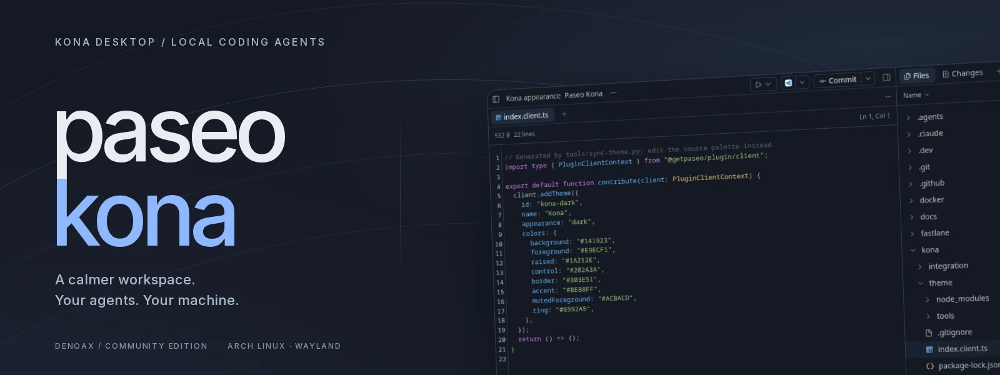
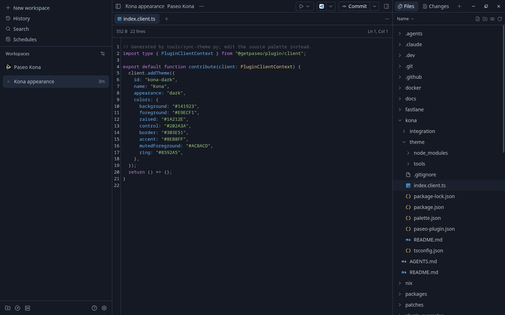
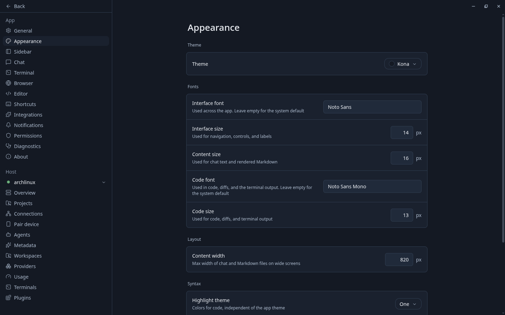
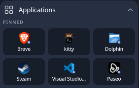

<div align="center">



# Paseo Kona

**A calmer workspace for local coding agents.**<br>
A community fork of [Paseo](https://github.com/getpaseo/paseo), with a soft Kona appearance and an Arch desktop launcher integration.

[Paseo 0.11.2](https://github.com/getpaseo/paseo/releases/tag/v0.11.2) · [Arch Linux / Wayland](https://archlinux.org/) · [Kona theme](kona/theme) · [Apache 2.0](LICENSE)

[Showcase](#the-workspace) · [Install the theme](#install) · [Kona launcher](#one-click-from-kona) · [Source map](#source-map) · [Credits](#credits)

</div>

## The workspace

Paseo brings agents, worktrees, code, diffs, terminals, and a browser into one
workspace. The Kona layer gives that workspace gentle navy depth, off-white
reading text, subdued edges, and blue accents tied to useful controls.



This is the real Paseo 0.11.2 renderer with the included plugin. The public capture
profile contains this repository and an empty workspace; no personal
conversations are shown. [Capture and artwork sources](showcase/kona/README.md).

## A quieter dark appearance



The palette lifts the darkest surface slightly and keeps bright blue out of
ordinary dividers and message fills. Main, secondary, and placeholder colors
meet 4.5:1 contrast on the three checked reading surfaces. Font settings remain
under your control: the captures use Noto Sans, a 14px interface, 16px content,
and 13px code.

| Included here                                             | Source                                                                             |
| --------------------------------------------------------- | ---------------------------------------------------------------------------------- |
| Kona dark theme through the supported plugin API          | [`kona/theme`](kona/theme)                                                         |
| Portable palette, regeneration, contrast and input checks | [`palette.json`](kona/theme/palette.json), [`tools`](kona/theme/tools)             |
| Sixth pin in the existing Kona application grid           | [`pin-paseo.patch`](kona/integration/pin-paseo.patch)                              |
| Complete Paseo 0.11.2 source and upstream documentation   | [`packages`](packages), [`docs`](docs), [`README.upstream.md`](README.upstream.md) |

## One click from Kona

<p align="center">
  
</p>

The pin fills the sixth position beside Visual Studio Code. Clicking focuses an
existing Paseo window or launches it through its desktop entry. The original
five pins stay in place. [Apply the launcher integration](kona/README.md#pin-in-kona-desktop).

## Install

Use an installed Paseo **0.11.2** and an agent CLI configured with your credentials.
The plugin's supported host range is `>=0.11.2 <0.12.0`; 0.11.2 is tested.

```sh
git clone --branch kona https://github.com/Denoax/paseo-kona.git
cd paseo-kona
paseo plugin install ./kona/theme
```

Enable plugins in **Settings → Plugins**, then choose **Kona** in
**Settings → Appearance**. Paseo compiles the plugin; installing its development
dependencies is only needed when editing or checking it. The contributed code
sets colors and has no backend entrypoint.

For desktop integration, palette refresh, existing sessions, and the validation
boundary, read [Kona setup](kona/README.md). To build the full application, follow
[upstream development](docs/development.md). This fork has no separately packaged
Kona binary release yet.

## Source map

```text
kona/
  theme/          supported theme plugin, palette and focused checks
  integration/    Kona pin patch and desktop-entry example
showcase/kona/    real captures, banner source and social-preview image
packages/        preserved upstream app, daemon, desktop and CLI
docs/            upstream architecture, development and provider contracts
```

The `kona` branch starts from upstream `v0.11.2`, commit
`75953250959979b8f088bbca8dbd6ee61d0151b1`. Keep updates explicit and review each
new upstream release. [Fork maintenance](kona/README.md).

## Check the Kona layer

```sh
npm --prefix kona/theme ci --legacy-peer-deps
npm --prefix kona/theme run typecheck
python3 kona/theme/tools/sync-theme.py --check
python3 -m unittest discover -s kona/theme/tools -p 'test_*.py'
```

Local checks cover the plugin contract, palette regeneration, invalid inputs,
reading contrast, the rendered Arch appearance, and the launcher action.
The full upstream app suite and mobile platforms were not rerun for this layer.
Animation behavior and performance remain upstream.

## Credits

- **Paseo:** Mohamed Boudra and [upstream contributors](https://github.com/getpaseo/paseo), under the retained [Apache 2.0 license](LICENSE). The Paseo mark and existing third-party notices remain attributed to their owners.
- **Kona integration and repository artwork:** Mani Marami Milani / [Denoax](https://github.com/Denoax).
- **Presentation references:** [Kona Desktop](https://github.com/Denoax/konata-hyprland-dotfiles) for banner-first documentation and screenshot-led galleries; [the portfolio](https://github.com/Denoax/portfolio) for typography, restrained lighting, and spatial line work. Their visual assets are not copied.
- **Inter:** Rasmus Andersson, [SIL Open Font License](showcase/kona/sources/Inter-OFL.txt).

The banner uses original HTML/CSS/SVG and an actual app capture. No generated
visual media, fabricated activity, or private transcripts are included.

<div align="center">

**Paseo, in the Kona desktop family.**<br>
[Upstream project](https://github.com/getpaseo/paseo) · [Kona Desktop](https://github.com/Denoax/konata-hyprland-dotfiles) · [Portfolio](https://manimarami.com/)

</div>
